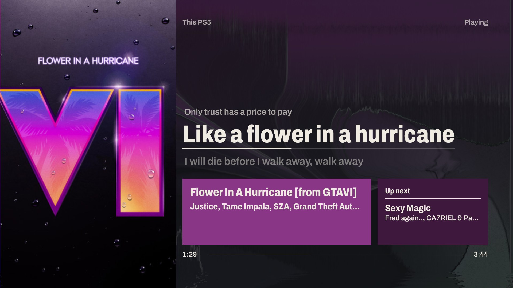
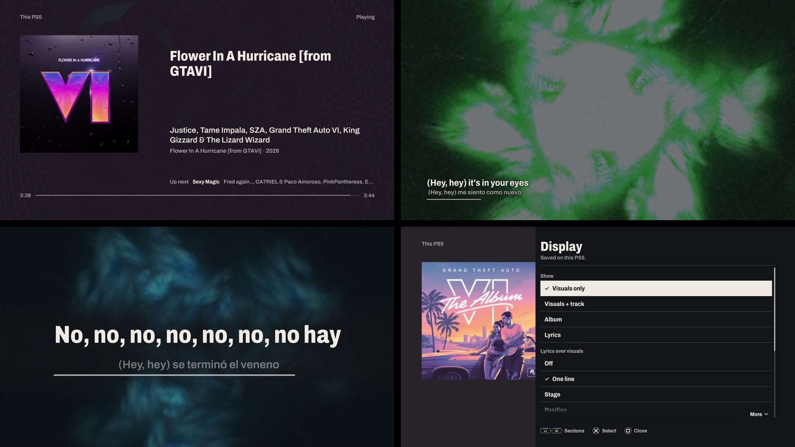

<p align="center">
  <picture>
    <source media="(prefers-color-scheme: dark)" srcset="docs/brand/afterglow-wordmark-paper.svg">
    
  </picture>
</p>

<p align="center">
  
</p>

# Afterglow for PS5

An unofficial Music Assistant player for a jailbroken PS5. It joins Music Assistant as a speaker and plays through
the console, shows the artwork, word-by-word lyrics and the queue, lets you browse and play with a DualSense, and
draws MilkDrop visuals from the music you hear. It can also follow another speaker and draw what that speaker plays,
without sounding a second copy.

It is the PS5 twin of [Afterglow for LG webOS](https://github.com/HaydenGriffin/afterglow): the same poster design
and the same Music Assistant account, written natively in C++ and OpenGL for the console.

Afterglow is independent of, and not endorsed by, Music Assistant or Sony Interactive Entertainment. It is built on
BlackBearReloaded's [ps5-homebrew-ui](https://github.com/blackbearreloaded/ps5-homebrew-ui) and keeps its licence,
GPL-3.0-or-later.

## What it does

- **Plays on the PS5.** Afterglow connects to Music Assistant's Sendspin server, so the console appears in Music
  Assistant as a speaker called *Afterglow PS5*. Play to it from Music Assistant, or from Afterglow's own Browse.
- **Follows a speaker.** Set the source to a speaker (or *Active speaker*) and the PS5 draws whatever it plays,
  through Music Assistant's MilkDrop Visualizer plugin, while staying silent itself.
- **Album, Lyrics and Visuals views.** Album shows the whole artwork with the song, artist and up next. Lyrics shows
  timed lyrics with the current line leading, word by word when the lyrics carry word timing, and plain lyrics paged
  by hand. Visuals is MilkDrop on its own or with a track card, and MilkDrop can keep running behind the artwork.
- **Lyrics from Music Assistant, with an online fallback.** When Music Assistant has none, the PS5 looks the song
  up on [LRCLIB](https://lrclib.net) itself (see [Privacy](#privacy)). **Lyrics timing** moves the words up to 10 s
  earlier or later, and **Retry lyrics** asks again.
- **Browse and Search.** Search with the system keyboard, recently played, favourite playlists, albums, songs and
  artists, radio, podcasts and audiobooks, artist pages. Play now, play next, add to the queue or start radio.
- **Queue.** Play, move and remove upcoming songs; shuffle, repeat, crossfade, keep playing when the queue ends,
  volume and sleep timer. **Playing on** picks the speaker, and picking a silent one moves the music there
  (**Play on this PS5** brings it to the console). **Speakers together** joins or leaves a sync group.
- **Presets.** 395 MilkDrop presets (393 enabled) through [projectM](https://github.com/projectM-visualizer/projectm). A preset
  scan measures each one on your console and keeps the ones that run smoothly. Presets can take their colours from
  the artwork, and favourites are shared with Music Assistant and your LG TVs.
- **Sound & sync.** TV output compensation sets this PS5's delay in Music Assistant, so it plays in time with your
  other speakers; picture and lyrics timing have their own control. 30, 60 or 120 fps.
- **Light bar and Home.** The DualSense light bar takes the artwork's colour, and an optional Home section shows a
  few Home Assistant sensors and switches.



## Requirements

- A PS5 that runs homebrew: a jailbreak with a homebrew enabler that starts native titles from
  `/data/homebrew/<TITLE_ID>`, such as [ShadowMount Plus](https://github.com/drakmor/ShadowMountPlus), and an FTP
  server to copy the app across. The [setup guide](docs/install.md#1-what-you-need) has the details.
- [Music Assistant](https://music-assistant.io/) 2.10 or newer on the same network, reachable by its numeric IPv4
  address. To follow other speakers, also its **MilkDrop Visualizer** plugin.
- For following, speakers Music Assistant streams to itself (Sonos, Chromecast, AirPlay, Squeezelite, ...). A
  speaker playing on its own, such as Spotify straight from the Spotify app, carries nothing to draw.

> **Status:** Afterglow has run on one PS5, on system software 7.61. Playback through the console, artwork, the
> title and MilkDrop at 59.9–60 fps with no audio dropouts were checked there on an earlier build. Everything added
> since, including the controls in this README, sign-in, the light bar, 120 Hz and the Home section, has been
> tested on a PC (unit tests, mock servers and the off-screen preview) but not yet on a console. Other consoles,
> firmware versions and homebrew enablers haven't been tried. Reports either way are very welcome.

## Install

Download `PPSA99481.zip` from the [releases](https://github.com/HaydenGriffin/afterglow-ps5/releases), or build it
(below). Extract it and copy the `PPSA99481` folder to `/data/homebrew/` on the console over FTP. Wait for your
homebrew enabler to register the title, then start **Afterglow** from the home screen.

Sign in with Options → Settings → Account → **Sign in**: the system keyboard asks for Music Assistant's address,
your username and password. The PS5 keeps its own long-lived token, named after the console, which you can revoke
in Music Assistant or with **Log out**; the password is not stored. Then choose *Afterglow PS5* as the speaker in
Music Assistant and play something. The [setup guide](docs/install.md) walks through every step, including the
optional `afterglow.conf`.

## Controls

On the poster or the visuals, with nothing open:

| Button | Does |
| --- | --- |
| Cross | Play / pause |
| L1 / R1 | Previous / next song |
| D-pad left / right | Back / ahead 10 seconds |
| D-pad up / down | Volume; pages plain lyrics in the Lyrics view |
| Square | Visuals only, Visuals + track, Album, Lyrics |
| Triangle | Lyrics over the visuals: off, one line, stage |
| L2 / R2 | Previous / next preset; in the Lyrics view, lyrics earlier / later |
| L3 | Lock the preset |
| R3 | Favourite the preset |
| Options | The playback controls and the Browse, Now playing, Queue and Settings sheets |
| Hold Circle | Close Afterglow (1.5 s) |

In the sheets, up and down move, left and right change a value, Cross selects, Circle goes back and Options closes
everything. The full list is in [docs/AFTERGLOW.md](docs/AFTERGLOW.md#controls).

## Settings

Press **Options** for the playback controls: a row of tiles (previous, play, next, back and ahead 10 s, favourite,
Details, Display) and a strip with **Browse**, **Now playing**, **Queue**, **Settings** and, once configured,
**Home**. Settings holds the source, visuals and presets, lyrics timing, sound and sync, the account and a status
page. Settings for this console are kept on the console and, with **Sync settings with Music Assistant** on, in your
Music Assistant account; preset favourites are shared with your other Afterglows. Every row is described in
[docs/AFTERGLOW.md](docs/AFTERGLOW.md).

## Privacy

Afterglow talks to your Music Assistant server: Sendspin for the audio, its API for artwork, lyrics, the queue and
your library, and the MilkDrop Visualizer relay when following a speaker. Artwork comes through Music Assistant's
image proxy. With a Home section configured, it also talks to your Home Assistant, subscribing only to the entities
you list.

The one other service is lyrics. When Music Assistant has none for a song, the PS5 asks
[lrclib.net](https://lrclib.net) directly over HTTPS, sending only the song's title and first artist (no account,
token or device id); LRCLIB sees the request coming from your network. Turn **Online lyrics** off (Options →
Settings → Lyrics) to stop it; it is on by default.

The console stores its Music Assistant token in the app's own storage (`/download0/hui/afterglow.auth`), never your
password. A token or Home Assistant token you put in `afterglow.conf` sits in the install folder, which anything with
FTP access to the console can read. There is no analytics or telemetry. The dev request path for checking a console
from a PC is off unless you turn it on.

## Development

The build runs in a Linux container (native on ARM64 and x86-64; on a Mac, Colima or another local Docker works) and
cross-compiles for the PS5 with the public [PS5 Payload SDK](https://github.com/ps5-payload-dev/sdk):

```sh
docker build -f Dockerfile.afterglow -t afterglow-builder .
docker run --rm -v "$PWD:/work" afterglow-builder make app    # dist/PPSA99481/ and dist/PPSA99481.zip
docker run --rm -v "$PWD:/work" afterglow-builder make test-unit
docker run --rm -v "$PWD:/work" afterglow-builder make lint
```

The interface also renders on a PC, off-screen, with the same code and shaders. The README images come from it, on
made-up music and an invented cover:

```sh
AFTERGLOW_PREVIEW=1 AFTERGLOW_COVER=docs/images/preview-cover.png AFTERGLOW_LYRICS=karaoke \
  tools/host-snapshots.sh build/afterglow-preview afterglow
```

[docs/AFTERGLOW.md](docs/AFTERGLOW.md) covers the configuration file, the preset scan, the checks and what has not
been verified on hardware. [AGENTS.md](AGENTS.md) is the guide for working in the repository (for people and coding
agents alike), and [docs/UI_KIT.md](docs/UI_KIT.md) introduces the ps5-homebrew-ui kit underneath. See the
[changelog](CHANGELOG.md).

## Support

Afterglow is free and open source. If it made your setup better, you can
[buy me a coffee](https://buymeacoffee.com/haydengriffin). Bug reports and pull requests are just as welcome.

## Credits

- [ps5-homebrew-ui](https://github.com/blackbearreloaded/ps5-homebrew-ui) by BlackBearReloaded (GPL-3.0-or-later),
  the kit, build and packaging Afterglow is built on, with
  [ps5-native-app-boilerplate](https://github.com/blackbearreloaded/ps5-native-app-boilerplate) and
  [ps5-opengl](https://github.com/blackbearreloaded/ps5-opengl).
- The [PS5 Payload SDK](https://github.com/ps5-payload-dev/sdk) by John Törnblom (ps5-payload-dev).
- [projectM](https://github.com/projectM-visualizer/projectm) (LGPL-2.1-or-later), the MilkDrop renderer.
- [butterchurn-presets](https://github.com/jberg/butterchurn-presets) and the MilkDrop preset authors.
- [Archivo](https://github.com/Omnibus-Type/Archivo) typeface (SIL OFL 1.1).
- [jsmn](https://github.com/zserge/jsmn) (MIT) and [stb](https://github.com/nothings/stb) (public domain or MIT).
- Lyrics fallback by [LRCLIB](https://lrclib.net).

Full notices, with what the app folder ships, are in [THIRD_PARTY_NOTICES.md](THIRD_PARTY_NOTICES.md).

## Licence

GPL-3.0-or-later; see [LICENSE](LICENSE). Afterglow's additions are by Hayden Griffin; the ps5-homebrew-ui code it is
built on is Copyright © 2026 BlackBearReloaded. Third-party components keep their own licences.

## Disclaimer

- **No affiliation.** "PlayStation", "PS5" and "DualSense" are trademarks of Sony Interactive Entertainment Inc.
  Music Assistant is its own project. Neither endorses Afterglow.
- **No proprietary material.** No Sony SDK, firmware, encryption keys or decrypted system modules are included.
- **Use at your own risk.** Running homebrew requires a modified console, which may void its warranty, breach the
  platform's terms of service, or cause data loss. Afterglow is provided "as is", without warranty; see sections 15
  and 16 of the GPL.
- **Legal use only.** Use it only with hardware, accounts and music you own or are licensed to play.
